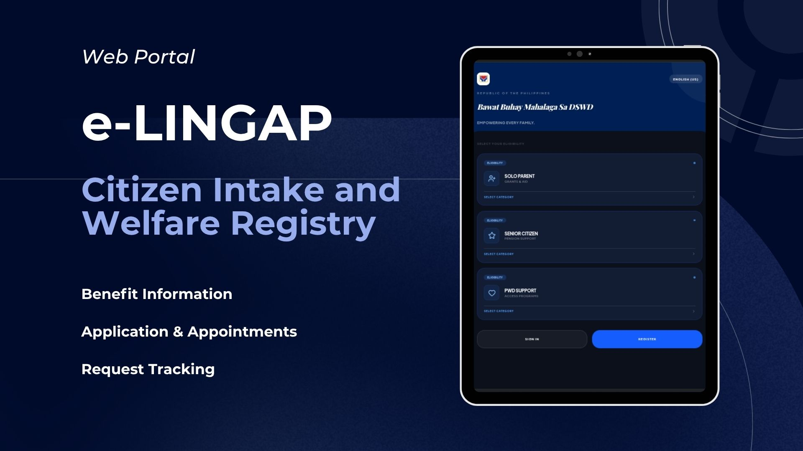

# e-LINGAP

### Citizen Intake and Welfare Registry

<p align="center">
  
</p>

e-LINGAP is a web portal concept for organizing citizen welfare services in one accessible place. It supports **solo parents**, **senior citizens**, and **persons with disabilities (PWDs)** by bringing benefit information, applications, appointment scheduling, and request tracking into a single digital experience.

## What the project does

- Presents benefit and support information by citizen category.
- Lets users register, sign in, and manage a personal profile.
- Supports ID applications and renewals, document submissions, and appointment scheduling.
- Gives users a tracker for active applications and appointments, including rescheduling or cancellation actions.
- Provides status updates, announcements, notifications, and a help section.
- Includes English and Filipino interface content, plus light and dark themes.
- Includes an admin-oriented workflow for managing shared content and reviewing appointment activity.

## Project focus

The project explores how a welfare portal can make common public-service tasks easier to understand and follow. Rather than requiring citizens to check multiple places, e-LINGAP brings service details, submission progress, and appointments together in one guided flow.

## Built with

- React 19 and TypeScript
- Vite
- Tailwind CSS
- Firebase Authentication
- Cloud Firestore
- Firebase Realtime Database
- Lucide React icons

## Run locally

1. Clone the repository.
2. Install dependencies:

   ```bash
   npm install
   ```

3. Create a `.env` file in the project root and add your Firebase web-app values:

   ```env
   VITE_FIREBASE_API_KEY=your_key
   VITE_FIREBASE_PROJECT_ID=your_project_id
   VITE_FIREBASE_APP_ID=your_app_id
   VITE_FIREBASE_AUTH_DOMAIN=your_project_id.firebaseapp.com
   VITE_FIREBASE_STORAGE_BUCKET=your_bucket
   VITE_FIREBASE_MESSAGING_SENDER_ID=your_sender_id
   VITE_FIRESTORE_DATABASE_ID=(default)
   VITE_FIREBASE_RTDB_URL=your_realtime_database_url
   ```

4. Start the development server:

   ```bash
   npm run dev
   ```

5. Open the local address shown in the terminal.

## Security note

Firebase Authentication is used for sign-in. Firestore and Realtime Database rules must be configured and deployed separately before using real citizen information. Test access rules thoroughly and do not place private records in public collections.

## Repository contents

- `src/` - React application screens, components, and Firebase integration.
- `images/` - Project visual assets and README thumbnail.
- `firestore.rules` and `database.rules.json` - database rule definitions.
- `firebase-blueprint.json` - application data-model reference.

---

Built as a practical web-development project by [Louise Catala](https://github.com/LouiseCatala).
